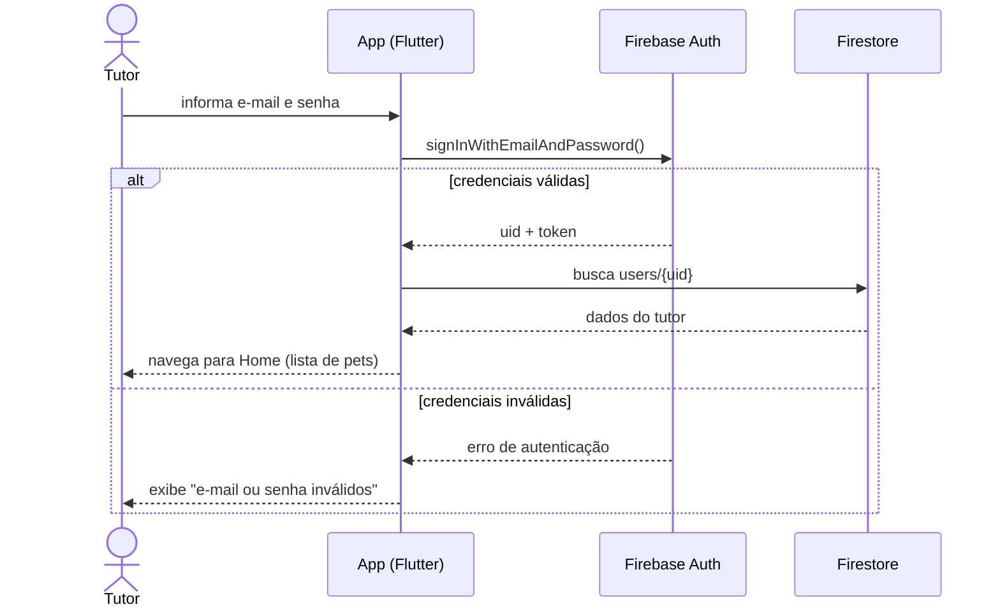
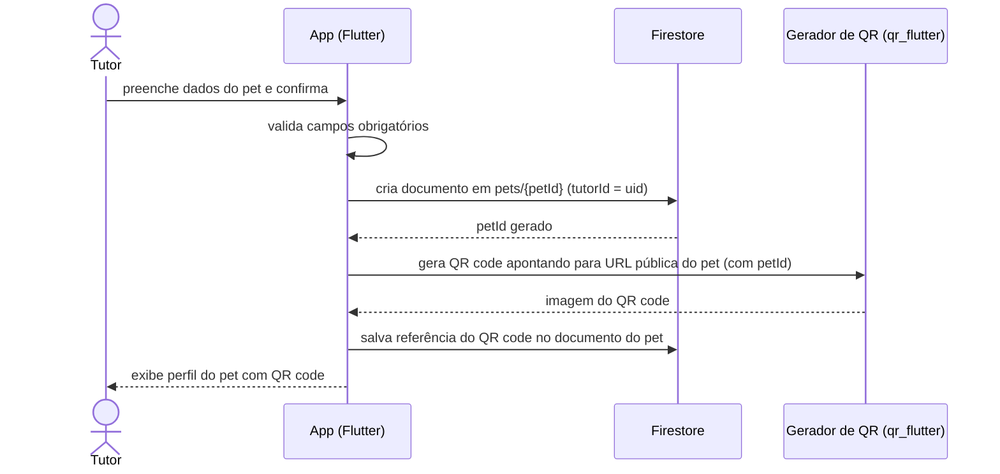
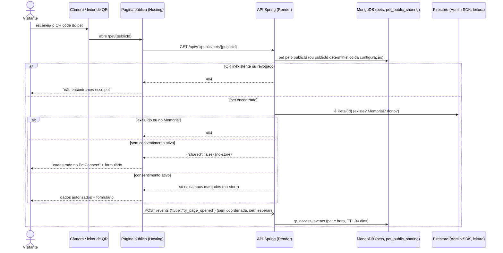

# Diagramas de Sequência — PetConnect

> ⚠️ **Legado**: as sequências abaixo mostram o app falando direto com
> o Firestore — válido só para quando as feature flags (`USE_API_*`)
> estão desligadas. Com a flag ligada, o passo "Firestore" abaixo é
> substituído por "API Spring Boot → MongoDB" (ver
> `docs/diagramas/arquitetura.md`); a sequência de interação (usuário →
> tela → repositório) não muda, só o que está atrás do repositório.

## 1. Login do tutor (RF04, RF06)



Login com Google (RF04-A), incluindo a vinculação de conta existente:
diagramas em `docs/features/login-social.md`.

## 2. Cadastro de pet e geração de QR code (RF10, RF16)



## 3. Visitante escaneia o QR code (RF17, RF18, RF51)

Atualizado em 2026-11-02 (issue #35). A página é estática no Firebase
Hosting e lê os dados pela API Spring; não há Cloud Function.



### Visitante relata o avistamento e o tutor vê (RF31, RF32, RF52)

Adicionado em 2026-11-03 (issue #37). A localização só é pedida depois do
clique e vai uma vez, quando o visitante envia.

```mermaid
sequenceDiagram
    actor Visitante
    participant Nav as Navegador (Geolocation)
    participant Web as Página pública
    participant API as API Spring
    participant Mongo as MongoDB (locations, qr_access_events)
    actor Tutor
    participant App

    Visitante->>Web: toca em "Compartilhar local onde vi o pet"
    Web->>Nav: getCurrentPosition (alta precisão, 15 s)
    alt permissão negada ou sem sinal
        Nav-->>Web: erro
        Web-->>Visitante: "descreva onde viu o pet" (relato em texto continua possível)
    else posição obtida
        Nav-->>Web: latitude, longitude, precisão
        Web-->>Visitante: "pronta para enviar, precisão de cerca de X m" + Conferir no mapa / Não enviar
    end
    Visitante->>Web: Enviar relato
    Web->>API: POST /sightings {coordenada?, accuracyMeters?, texto?, clientRequestId}
    API->>Mongo: locations (positionSource decidido pelo servidor; mesmo clientRequestId não duplica)
    API-->>Web: 201 sem corpo
    Tutor->>App: abre Localização do pet
    App->>API: GET /legacy-pets/{id}/qr-activity (token)
    API->>Mongo: relatos e acessos do pet (dono conferido no Firestore)
    API-->>App: sightings + recentAccesses + accessesLast30Days
    App-->>Tutor: relatos com precisão e "Abrir no mapa"; acessos à parte
```

### Tutor publica ou revoga (RF51)

```mermaid
sequenceDiagram
    actor Tutor
    participant App
    participant API as API Spring
    participant Store as Firestore (Admin SDK, leitura)
    participant Mongo as MongoDB

    Tutor->>App: marca campos e o consentimento, toca em Publicar
    App->>API: PUT /legacy-pets/{id}/public-sharing (token)
    API->>Store: lê Pets/{id}; userId = UID do token?
    alt outro dono ou pet inexistente
        API-->>App: 404
    else dono
        API->>Mongo: salva pet_public_sharing e grava o evento ACCEPTED/UPDATED
        API-->>App: configuração ativa
    end
    Tutor->>App: Desativar página pública
    App->>API: PUT {"enabled": false}
    API->>Mongo: revoga, apaga telefone e nome, grava REVOKED
    API-->>App: desativada (vale no acesso seguinte)
```

## Galeria de fotos do pet (RF37–RF42)

Publicar, listar e excluir, com o tratamento de falha parcial: ver
`docs/features/galeria-fotos-pet.md` ("Arquitetura").

## Cartaz de pet desaparecido (RF43–RF49)

Prévia, captura em PNG, PDF e compartilhamento: ver
`docs/features/cartaz-pet-desaparecido.md` ("Arquitetura").
