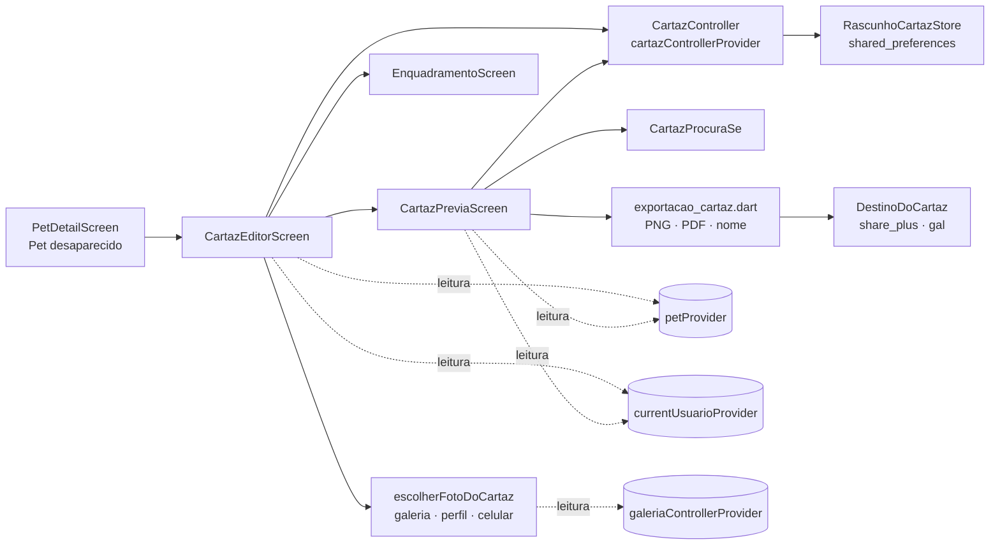
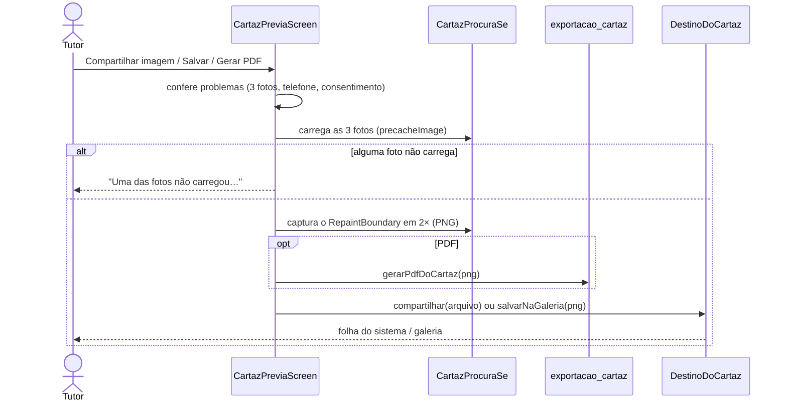

# Cartaz de pet desaparecido (RF43–RF49)

> Branch: `feat/cartaz-pet-desaparecido` (2026-10-29). Pedido em
> `prompt_opus_cartaz_pet_desaparecido_petconnect.md`. Decisão de
> arquitetura em `docs/decisions/0007-cartaz-gerado-no-aparelho.md`.
> Roteiro de aparelho em `docs/validation/cartaz-pet-desaparecido.md`.

O tutor monta um cartaz "Procura-se" com os dados reais do pet, três fotos e
o telefone que autorizar, confere a prévia e salva ou compartilha em PNG ou
PDF. **O cartaz é gerado no celular.** Nada é publicado no app, nada vai
para o Firestore ou o Cloudinary, e o cadastro do pet não muda.

## Estado

| Parte | Situação |
|---|---|
| Código e testes automatizados | Prontos (branch acima, PR aberta, sem merge) |
| Banco, regras e backend | **Sem mudança.** Nenhuma coleção, campo, regra ou endpoint novo |
| Permissões Android | **Sem mudança.** Conferido no APK de release (`aapt2 dump permissions`) |
| Teste no aparelho | Pendente com o proprietário: `docs/validation/cartaz-pet-desaparecido.md` |

## Jornada

1. Perfil de um pet ativo → **Pet desaparecido** (primeiro item das ações
   secundárias, acima de Fotos e Localização).
2. O editor explica o que é o cartaz, mostra o pet (foto, nome, espécie e
   raça, do cadastro) e as três posições: **Foto principal**, **Foto 2** e
   **Foto 3**.
3. Cada posição abre a escolha da foto:
   - galeria do pet, quando ligada (`GALERIA_FOTOS`);
   - a foto do perfil;
   - uma foto do celular, pelo seletor do sistema.
   Uma foto já usada em outra posição aparece marcada e não pode ser
   escolhida de novo. Com a foto escolhida, a posição oferece trocar,
   **ajustar enquadramento** (arrastar, zoom e controles deslizantes),
   mover para outra posição ou remover.
4. Campos de texto, todos revisáveis:
   - **Características**, que começa com uma sugestão do cadastro (sexo e
     porte);
   - opcionais: **Visto por último em**, **Desapareceu em**,
     **Observações** e **Recompensa**.
5. **Contato:** o telefone do cadastro do tutor, ou o contato do QR code do
   pet quando for outro número. O tutor precisa marcar "Autorizo mostrar
   este telefone no cartaz". Sem telefone válido, o editor avisa e leva a
   Editar perfil.
6. **Ver cartaz** abre a prévia, que é o próprio cartaz, com zoom. Enquanto
   faltar algo, a prévia lista o que falta e os botões ficam desligados.
7. **Compartilhar imagem** (PNG), **Salvar imagem** (galeria de fotos) ou
   **Gerar PDF** (A4, pela folha de compartilhamento). Nada sai do aparelho
   sem um desses toques.

Voltar funciona em todas as telas sem fechar o app: editor → perfil,
prévia → editor, enquadramento → editor.

## Regras

| Regra | Como funciona | Onde |
|---|---|---|
| Só o tutor dono, só pet ativo | As rotas `/pet/:id/cartaz` e `/pet/:id/cartaz/previa` usam `PetSituacaoGuard` (`SituacaoPet.ativo`): pet no Memorial mostra o aviso do Memorial, e pet de outra conta mostra "Pet não encontrado". As telas conferem o dono de novo | `pet_routes.dart`, telas |
| Título pela espécie | "GATO DESAPARECIDO", "CACHORRO DESAPARECIDO" ou, para qualquer outra espécie ou espécie vazia, "PET DESAPARECIDO". Aceita variações (cão, cadela, gata, felino, caixa e acentos) sem alterar o cadastro | `TituloCartaz.daEspecie` |
| Dados do cadastro | Nome, espécie/raça e cor vêm do `Pet`; o telefone vem do `Usuario` (ou `Pet.telefone`) | `ConteudoCartaz.de` |
| Exatamente 3 fotos | A prévia aceita rascunho incompleto (espaço vazio com o nome da posição); a exportação exige as 3 | `problemasDoCartaz` |
| Fotos independentes do perfil | Escolher uma foto não muda a foto de perfil nem a galeria | — |
| Campos vazios somem | Sem rótulo vazio, sem "null"; recompensa vazia tira a linha inteira | `ConteudoCartaz.de` |
| Sem local inventado | "Visto por último em" é texto livre e opcional. Não há GPS nem permissão de localização | — |
| Telefone válido | Brasileiro, com DDD (10 ou 11 dígitos, `+55` opcional). Número de outro país, incompleto ou com DDD inválido é recusado. Mostrado como `(11) 90000-0000` | `telefoneDoCartaz` |
| Consentimento específico | Vale para o número autorizado: trocar o número pede de novo. Não é salvo no rascunho. Sem ele, o cartaz mostra o espaço do contato vazio e não exporta | `RascunhoCartaz.telefoneAutorizado` |
| Sem e-mail nem endereço | Nunca entram no cartaz | — |
| Nada muda no pet | Gerar e exportar não grava no Firestore e não lê vacinas, consultas, histórico nem localização | `cartaz_telas_test.dart` |
| Repetir não duplica | Exportar de novo gera outro arquivo local; não há registro nem upload | — |
| Limites de texto | Características 80, Visto por último em 50, Desapareceu em 30, Observações 100, Recompensa 30 (contador no campo) | `LimitesCartaz` |

**Fora do escopo nesta entrega** (ver ADR 0007):
- estado "desaparecido" no pet e "Declarar desaparecido";
- aviso "ENCONTRADO";
- publicação no app, feed, mapa, link ou QR público;
- notificações;
- recompensa paga.

## Layout

Referência: o modelo minimalista "Procura-se" enviado pelo proprietário
(2026-10-29). O cartaz moderno citado como referência secundária não foi
recebido.

```text
┌──────────────────────────────┐
│ ███████ PROCURA-SE ███████   │  cabeçalho preto
│ ╱ [NOME DO PET] ╱            │  faixa branca inclinada (-0,03 rad)
│      CACHORRO DESAPARECIDO   │  título pela espécie
│ ┌───────────┐ ┌──────┐       │
│ │ principal │ │ foto2│       │  mosaico: 62% | 38%
│ │           │ ├──────┤       │
│ │           │ │ foto3│       │
│ └───────────┘ └──────┘       │
│ Nome:          [ ........ ]  │  só os campos preenchidos
│ Espécie/Raça:  [ ........ ]  │
│ ...                          │
│ ██ CONTATO: [ (11) 9....  ]  │  rodapé preto
│        Cartaz gerado no app… │  marca discreta
└──────────────────────────────┘
```

- **Tamanho fixo:** 1055 × 1491 lógicos, a proporção do modelo (próxima do
  A4). O cartaz tem cores próprias (preto `#111111`, branco, cinza
  `#EDEDED`), que não mudam com o tema do app, e ignora o tamanho de fonte
  do sistema.
- **Fonte:** a do app (Roboto). Não há fonte condensada no projeto; usar a
  do modelo exigiria incluir um arquivo de fonte licenciado, o que fica
  como sugestão.
- **Fotos:** cobrem o espaço sem esticar (`BoxFit.cover`), com o
  enquadramento escolhido (ponto de ancoragem e zoom de 1× a 3×).
- **Textos longos:**
  - o nome encolhe para caber na faixa, numa linha;
  - os dados quebram linha. Se passarem do espaço, encolhem juntos, e as
    fotos mantêm no mínimo 340 px de altura;
  - com a Roboto, o cartaz completo fica em 95% e o caso com todos os
    textos no limite, em 84% (`test/evidencias/cartaz_evidencia_test.dart`);
  - nada é cortado.
- **Prévia e arquivo iguais:** a prévia é o próprio widget
  (`CartazProcuraSe`), reduzido com `FittedBox`. A exportação captura esse
  mesmo widget.

## Exportação

| Saída | Como | Arquivo |
|---|---|---|
| PNG | Captura do `RepaintBoundary` da prévia em 2×: **2110 × 2982 px** | `petconnect_procura-se_<8 hex>_<aaaammdd>.png` |
| PDF | O mesmo PNG numa página A4 em pé, margem de 24 pt, centralizado (`pdf`); cerca de 250 dpi na folha | `....pdf` |
| Compartilhar | Folha do sistema (`share_plus`), com o arquivo e o tipo MIME; o tutor escolhe o app (WhatsApp, e-mail, Drive…) | arquivo temporário no cache do app, apagado depois (ver Privacidade) |
| Salvar imagem | Galeria de fotos (`gal`, MediaStore). No Android 10 ou mais novo não precisa de permissão; no 9 ou anterior o app avisa para usar "Compartilhar imagem" | — |

- **Nome do arquivo:** o identificador é o começo do SHA-256 do id do pet.
  Sem nome, telefone ou id interno.
- **Metadados:** o PNG é gerado a partir dos pixels, então não leva
  metadados das fotos originais. O PDF tem só título ("Procura-se") e
  criador ("PetConnect").
- **Fotos que não carregam** (sem internet, foto apagada da galeria):
  bloqueiam a exportação com aviso. O cartaz nunca sai com um buraco.
- **Avisos:** "Cartaz salvo na galeria de fotos." só aparece depois de
  salvar. Compartilhar não mostra aviso de sucesso, porque o sistema nem
  sempre informa o que o tutor fez.

## Fotos

- **Fotos da galeria e do perfil** usam a versão limitada a 1600 px do
  Cloudinary. A URL é aceita só se for `https://res.cloudinary.com`.
- **Fotos do celular** vêm do seletor do sistema, que não pede acesso a
  todas as fotos.
  - A cópia é redimensionada para até 2048 px e recomprimida, com a
    orientação corrigida e sem os metadados do original
    (`requestFullMetadata: false`).
  - Passa por `validarImagem`: JPEG, PNG, WebP ou HEIC de até 10 MB.
  - Fica só na memória: não é enviada e não entra no rascunho.
- **Memória:** cada foto é decodificada com no máximo 1400 px de largura,
  e as miniaturas no tamanho exibido.

## Rascunho

- **Onde e com que chave:** fica só no aparelho (`shared_preferences`),
  com a chave `cartaz_rascunho_v1_<uid>_<petId>`.
- **O que guarda:** os textos, as fotos que já estão no Cloudinary do pet
  (id e URL) e o enquadramento.
- **O que não guarda:** o telefone (lido do cadastro na hora), o
  consentimento e as fotos do celular.
- **Gravação:** salva 400 ms depois da última mudança e ao sair do editor.
- **Sair com foto do celular** pede confirmação, porque ela não volta.
- **Descartar rascunho** (menu do editor) apaga o rascunho; excluir o pet
  também apaga o dele.
- **Rascunho ilegível** (outra versão, JSON corrompido, URL estranha) vira
  rascunho vazio em vez de erro.

## Arquitetura





| Arquivo | Papel |
|---|---|
| `lib/features/pet/domain/cartaz_desaparecido.dart` | Título, fotos, enquadramento, rascunho (JSON), telefone, campos e problemas |
| `lib/features/pet/data/rascunho_cartaz_store.dart` | Rascunho no aparelho |
| `lib/features/pet/data/exportacao_cartaz.dart` | PDF, nome do arquivo, `DestinoDoCartaz` (compartilhar e galeria) |
| `lib/features/pet/presentation/providers/cartaz_providers.dart` | `CartazController`, store e destino |
| `lib/features/pet/presentation/widgets/cartaz_procura_se.dart` | O cartaz (prévia e exportação) e `FotoEnquadrada` |
| `lib/features/pet/presentation/widgets/cartaz_fotos.dart` | Escolha de foto e `EnquadramentoScreen` |
| `lib/features/pet/presentation/screens/cartaz_editor_screen.dart` | Editor |
| `lib/features/pet/presentation/screens/cartaz_previa_screen.dart` | Prévia, captura e exportação |
| `lib/routing/pet_routes.dart` | Rotas protegidas |
| `lib/features/pet/presentation/widgets/pet_secondary_actions.dart` | Entrada no perfil |
| `lib/features/pet/presentation/screens/pet_settings_screen.dart` | Excluir o pet apaga o rascunho |

**Dependências novas** (licenças conferidas no pacote):

| Pacote | Versão | Licença | Para quê |
|---|---|---|---|
| `share_plus` | ^13.3.1 | BSD-3 | Folha de compartilhamento |
| `path_provider` | ^2.1.6 | BSD-3 | Pasta de cache do arquivo temporário (já vinha como dependência indireta) |
| `pdf` | ^3.13.1 | Apache-2.0 | PDF A4 |
| `gal` | ^2.3.3 | BSD-3 | Salvar na galeria |

Nenhum dos três adiciona permissão ao manifest. O `share_plus` declara só
um `FileProvider` interno (não exportado) e um receiver não exportado.

## Privacidade

- **Telefone:** consentimento explícito, informado e específico para o
  cartaz, ligado ao número. O texto do editor diz que qualquer pessoa que
  receber ou vir o cartaz verá o número.
- **Circulação:** o editor e a prévia avisam que o cartaz, depois de
  compartilhado ou impresso, pode continuar circulando e não dá para
  recolhê-lo.
- **Fora do cartaz:** e-mail, endereço, coordenadas, histórico médico,
  vacinas e ids internos.
- **Logs:** nenhum novo. Telefone, fotos e textos do cartaz não vão para
  log.
- **Fora do app:** nada é enviado a servidor do PetConnect.
- **Arquivos temporários:** o app grava o arquivo em `cache/cartaz/` e o
  apaga assim que a folha de compartilhamento termina. O `share_plus` faz
  a própria cópia em `cache/share_plus/` para o app escolhido ler. Essa
  cópia fica até o próximo compartilhamento (que limpa a pasta) ou até o
  Android limpar o cache.
- Detalhes em `docs/privacy/data-flow-and-lgpd-readiness.md`.

## Testes

| Arquivo | O que cobre |
|---|---|
| `test/features/pet/cartaz_dominio_test.dart` (21) | Título (gato, cachorro, outras e variações); telefone (válidos, inválidos, `+55`, outro país, formato, opções do tutor e do pet, escolha); 0 a 3 fotos e rascunho com 4; sem telefone; consentimento por número; campos e ordem; vazios somem; sugestão de características; troca de posições; limites do enquadramento; JSON sem telefone, consentimento e foto do celular; JSON corrompido e URL de fora; store por tutor e pet; nome do arquivo; PDF A4 de uma página |
| `test/features/pet/cartaz_layout_test.dart` (8) | Composição do modelo (mosaico, ordem vertical, rótulos); cachorro sem opcionais; nome longo; textos no limite com telefone fixo; enquadramento; espaços vazios; fonte do sistema 2× sem efeito; PNG 2110 × 2982. Goldens em `goldens/cartaz_*.png`, com tolerância de 2% (o golden com mais texto deu 1,09% de diferença entre Windows e o Linux do CI) |
| `test/features/pet/cartaz_telas_test.dart` (19) | Entrada pelo perfil e Voltar; Memorial e outro tutor bloqueados; escolher da galeria, foto já usada, mover e remover; galeria fora do ar; sem telefone; consentimento antes do número aparecer; trocar o número pede de novo; PNG, PDF e salvar (com e sem acesso); foto que não carrega; nada muda no pet nem se leem dados clínicos; rascunho volta sem consentimento; sair com foto do celular; descartar; editor em 320 px, tema escuro e fonte 1,5× |
| `test/evidencias/cartaz_evidencia_test.dart` (3, fora do CI) | Com a Roboto do SDK: escala dos dados de pelo menos 75% e PNG e PDF de exemplo, com dados fictícios, em `build/evidencias/` |

**Goldens:** no `flutter_test`, o texto sai em blocos (fonte de teste),
então os goldens conferem a composição, não a tipografia. A legibilidade
real é conferida no teste de evidência e no aparelho.

**Sem teste automatizado:**
- o seletor de fotos do sistema e a folha de compartilhamento reais (o
  destino é substituído por um fake nos testes);
- a gravação na galeria;
- HEIC e EXIF de fotos reais.

Esses casos ficam no roteiro de aparelho.

## Limites conhecidos

- **Galeria do pet no seletor:** só aparece com `GALERIA_FOTOS` ligada e no
  modo Firestore. Sem ela, as opções são a foto do perfil e o celular.
- **Foto do perfil antiga:** uma foto de perfil fora do Cloudinary não é
  oferecida.
- **Enquadramento:** a tela de enquadramento usa uma proporção aproximada
  do espaço no cartaz (a altura das fotos depende de quantos campos estão
  preenchidos). O recorte exato aparece na prévia.
- **Android 9 ou anterior:** "Salvar imagem" não funciona sem uma
  permissão de armazenamento, que não foi adicionada. O tutor usa
  "Compartilhar imagem".
- **Rascunho:** não é sincronizado entre aparelhos e some se o app for
  desinstalado.
- **Telefone:** só números brasileiros.

## Extensões futuras (não implementadas)

- **Estado de desaparecimento no pet:** exige campo e regras no Firestore,
  além da transição com o Memorial.
- **Cartaz "ENCONTRADO":** depende do estado acima.
- **QR code ou link público no cartaz:** sob consentimento e só depois da
  página pública (RF17–RF19).
- **Fonte condensada licenciada:** mais fiel ao modelo.
- **Histórico de versões do cartaz e métricas.**
