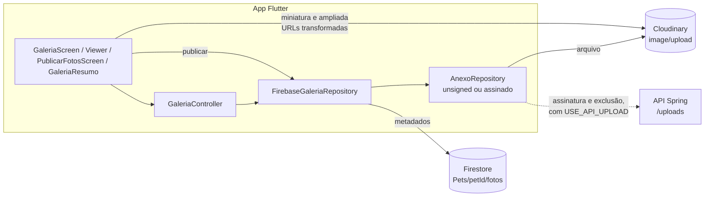
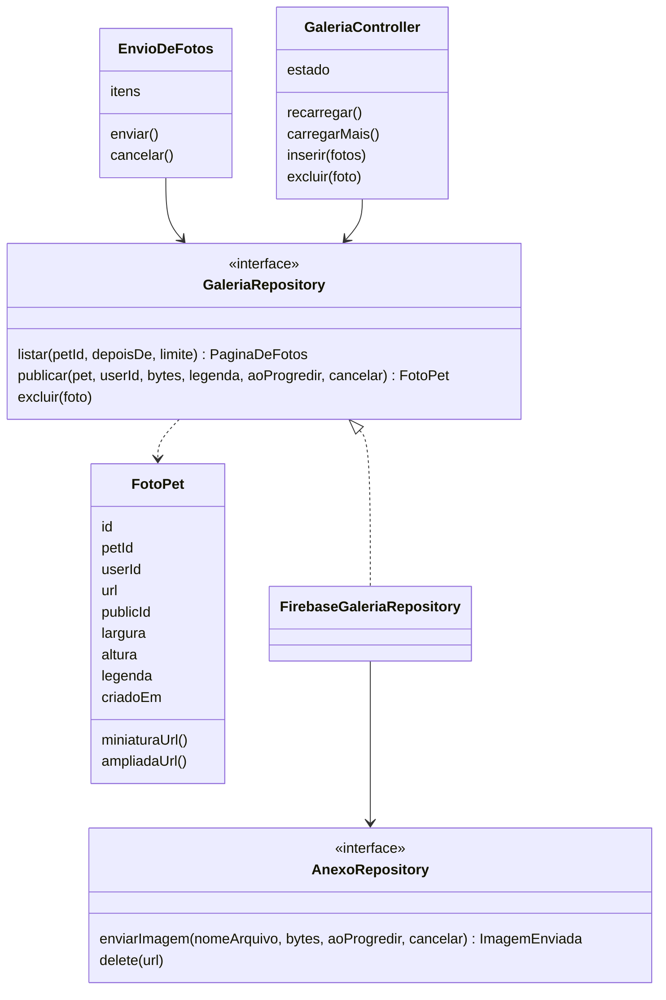
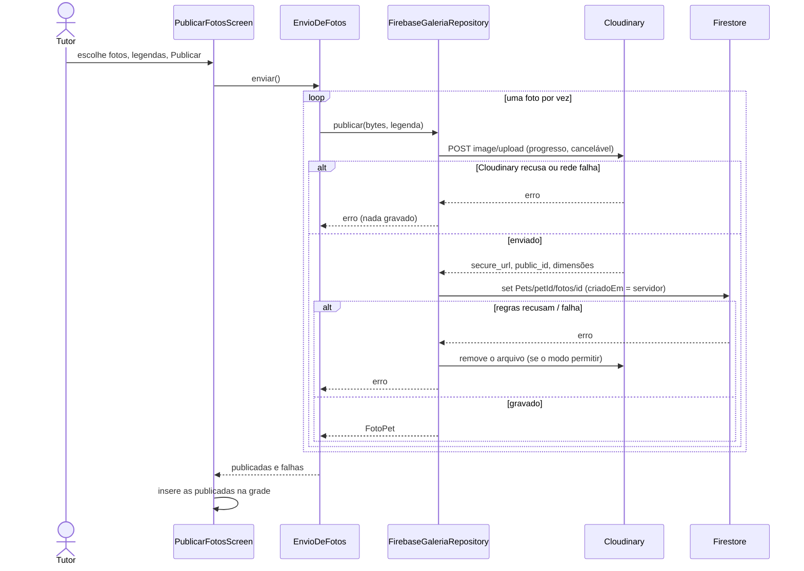
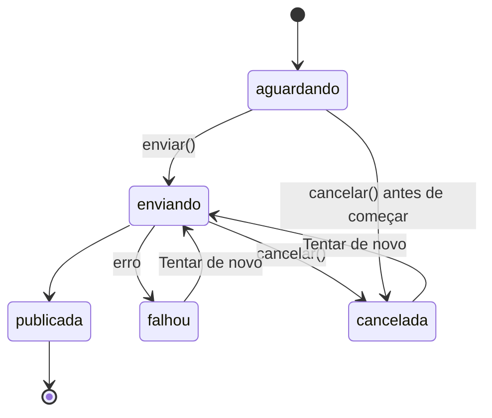
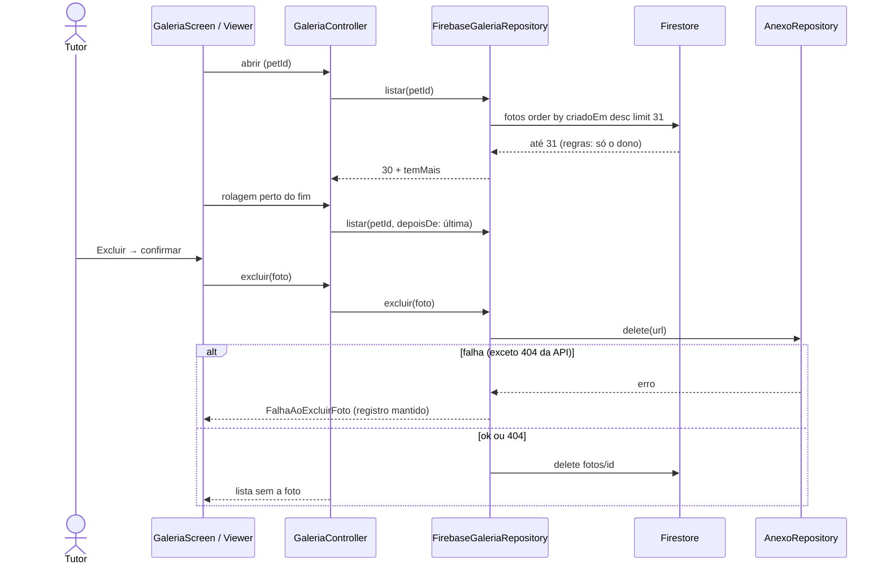

# Galeria de fotos por pet

Galeria **particular** de cada pet: o tutor publica, vê e exclui fotos do
próprio pet, inclusive de um pet no Memorial. A grade lembra a de um perfil
de rede social (miniaturas quadradas em 3 colunas, visualizador em tela
cheia), com a identidade do PetConnect e **sem** recursos sociais.

- Requisitos: RF37 a RF42 (`docs/requisitos-funcionais.md`), RNF19 a RNF23
  (`docs/requisitos-nao-funcionais.md`).
- Decisão de arquitetura: ADR 0005
  (`docs/decisions/0005-galeria-fotos-firestore-cloudinary.md`).
- Validação no aparelho: `docs/validation/galeria-fotos-pet.md`.

## Estado e como ligar

Desligada por padrão (`GALERIA_FOTOS`). **Não ligar em produção antes do
deploy das regras de isolamento por dono** (`firestore.rules`, issue #31):
as regras em vigor ainda têm o catch-all que deixa qualquer conta logada
ler e escrever em qualquer caminho, então as fotos de um tutor ficariam
acessíveis a outro.

```bash
flutter run --dart-define=GALERIA_FOTOS=true
```

Só no modo Firestore. Com `USE_API_PETS` a galeria some, como o Memorial:
os pets ficam no MongoDB, que ainda não tem galeria (ver "Modo API").

## Épico e histórias

**Épico:** guardar as fotos de cada pet num lugar só, privado, que continua
existindo depois que o pet morre.

| História | Critérios de aceite |
|---|---|
| Como tutor, quero ver as fotos do meu pet em grade, para reviver momentos. | Grade em 3 colunas, mais recentes primeiro; carrega em páginas de 30; estados de carregando, vazio, erro com "Tentar de novo". |
| Como tutor, quero abrir uma foto em tela cheia e passar para as outras. | Visualizador com zoom por pinça, deslizar entre fotos, legenda e data; o voltar do sistema fecha. |
| Como tutor, quero publicar várias fotos de uma vez, com legenda. | Até 10 por envio; prévia com legenda opcional (300 caracteres); progresso de cada foto; cancelar; sucesso parcial claro, com nova tentativa só das que falharam. |
| Como tutor, quero excluir uma foto que não quero mais. | Confirmação explicando que não dá para desfazer; se falhar, a foto continua e aparece o motivo. |
| Como tutor de um pet que morreu, quero continuar guardando fotos dele. | O Memorial mostra as 6 mais recentes, "Ver todas" e "Adicionar fotos"; recursos clínicos continuam ocultos. |
| Como tutor, quero que só eu veja essas fotos. | Outra conta e quem não está logado não listam, não leem, não publicam nem excluem (regras do Firestore). |

**Definition of Done:** critérios acima cobertos por teste automatizado;
regras testadas no emulador (CI); `flutter analyze` e `dart format` limpos;
documentação e CHANGELOG atualizados; checklist do aparelho entregue ao
proprietário; nada publicado ou deployado sem aprovação.

### Casos de uso

| Ator | Caso | Fluxo principal | Exceções |
|---|---|---|---|
| Tutor | Ver galeria | Perfil do pet → Fotos (ou Memorial → Ver todas) → grade | Sem fotos: convite para a primeira. Sem rede: aviso e nova tentativa. Pet de outro tutor: "Pet não encontrado". |
| Tutor | Adicionar fotos | Adicionar fotos → seletor do sistema → prévia e legendas → Publicar | Formato ou tamanho recusado: aviso e a foto fica de fora. Falha de rede: foto marcada, "Tentar de novo". Cancelar: as seguintes não são enviadas. |
| Tutor | Ver foto | Toque na miniatura → visualizador → deslizar | Erro ao carregar: "Tentar de novo". |
| Tutor | Excluir foto | Visualizador → Excluir → confirmar | Falha: aviso, foto mantida. |
| Tutor (Memorial) | Adicionar e ver | Memorial → Fotos → Adicionar fotos / Ver todas | As mesmas acima. |
| Outra conta / anônimo | Qualquer acesso | — | Negado pelas regras do Firestore. |

## Arquitetura





### Publicar





### Listar e excluir



## Modelo de dados

`Pets/{petId}/fotos/{fotoId}` (subcoleção, como `vacinas` e `consultas`).

| Campo | Tipo | Obrigatório | Observação |
|---|---|---|---|
| `petId` | string | sim | Igual ao id do pet pai; as regras conferem. |
| `userId` | string | sim | Auth UID de quem publicou; as regras conferem. |
| `url` | string | sim | `secure_url` original do Cloudinary (`https://res.cloudinary.com/<conta>/image/upload/...`). A interface usa versões transformadas. |
| `publicId` | string | sim | `public_id` do Cloudinary, para gerenciar o arquivo sem depender da URL. |
| `largura`, `altura` | int | não | Do Cloudinary. |
| `legenda` | string | não | Até 300 caracteres; vazia não é gravada. |
| `criadoEm` | timestamp | sim | `request.time` do servidor. |

- Sem índice composto: só `orderBy('criadoEm', desc)`, coberto pelo
  índice automático. Paginação por cursor de documento
  (`startAfterDocument`), que desempata pelo id.
- Sem edição nesta versão (`update` negado). Sem campo de ordem manual.
- Pets antigos não têm a subcoleção: galeria vazia, sem migração nem
  backfill. Foto de perfil e capa continuam onde estão (`Pets.foto`,
  `Pets.capa`) e não mudam.
- Extensão futura (curtidas, comentários): outra subcoleção ou serviço
  apontando para `fotoId`, sem mudar este documento. Nada disso foi criado.

## Upload, formatos e limites

| Item | Valor | Onde |
|---|---|---|
| Fotos por envio | 10 | `LimitesGaleria.fotosPorEnvio`, seletor do sistema (`limit`) |
| Maior lado enviado | 2048 px, JPEG 85 | seletor do sistema (cópia redimensionada; o original no aparelho não muda) |
| Tamanho por arquivo | 10 MB | app (antes do envio) e Cloudinary (limite do plano gratuito) |
| Formatos | JPEG, PNG, WebP, HEIC | app (assinatura dos primeiros bytes) e Cloudinary (endpoint `image/upload` recusa o que não é imagem) |
| Legenda | 300 caracteres | app e regras |
| Página da grade | 30 | `LimitesGaleria.porPagina` |

- O seletor é o do sistema (`pickMultiImage`): o app não pede permissão de
  acesso a todas as fotos.
- O arquivo vai com o id do registro como nome; o nome original do aparelho
  não sai do celular.
- Miniatura: `c_fill,w_360,h_360,q_auto,f_auto`. Ampliada:
  `c_limit,w_1600,h_1600,q_auto,f_auto`. Só aplicadas a URLs do padrão do
  app (`core/utils/cloudinary_url.dart`); outra URL é usada como está.
  Cada versão nova conta como transformação no plano do Cloudinary (2 por
  foto, criadas no primeiro acesso).
- O `CachedNetworkImage` guarda as imagens em disco com o limite padrão do
  pacote; a grade decodifica no tamanho exibido (`memCacheWidth`).

## Segurança e privacidade

- **Acesso:** só o dono do pet (`donoDoPet()` em `firestore.rules`), para
  listar, ler, criar e excluir — também com o pet no Memorial. A interface
  repete a checagem (rota com `PetSituacaoGuard`), mas quem garante são as
  regras. Testes: `tool/firestore-rules/regras.test.js`, bloco
  "fotos (galeria)".
- **Sem leitura pública**, nem pela página do QR. Memorial continua privado.
- **Segredos:** nenhum segredo do Cloudinary no app. No modo padrão o envio
  usa o preset unsigned (nome do preset não é segredo); com
  `USE_API_UPLOAD` a API assina o envio e a pasta `users/<tutorId>`.
- **URLs do Cloudinary são públicas para quem as tiver** (como as fotos de
  perfil de hoje). Não são listáveis nem adivinháveis, mas um link copiado
  abre a imagem. URL assinada ou entrega autenticada fica para quando houver
  exposição pública planejada.
- **EXIF/GPS:** do Android 10 em diante, o sistema não entrega a
  localização da foto a apps sem a permissão `ACCESS_MEDIA_LOCATION`, que o
  PetConnect não pede. No Android 7 a 9 (o app aceita a partir do 7) isso
  não vale, e o redimensionamento do seletor copia parte do EXIF para a
  cópia. A interface só exibe versões transformadas, que o Cloudinary
  entrega sem metadados, mas **o arquivo original guardado no Cloudinary
  pode conter GPS** nesses aparelhos. Não verificado no aparelho (item do
  checklist). A correção completa é uma transformação na entrada (no preset
  ou na assinatura da API), que é mudança na conta e pede aprovação (D3 da
  ADR 0005).
- **Conteúdo com pessoas:** a galeria é privada; não há moderação. Se um dia
  ficar pública, isso precisa de política própria.

### Retenção e exclusão

| Evento | Registros no Firestore | Arquivo no Cloudinary |
|---|---|---|
| Excluir foto | apagado | modo padrão: **fica** (exclusão exige a API secret); com `USE_API_UPLOAD`: apagado pela API |
| Excluir pet | apagados (`deletePet`) | fica |
| Excluir conta | apagados (`deleteAccount`) | fica |
| Pet no Memorial | mantidos | mantido |

Arquivos que ficam no Cloudinary não aparecem em lugar nenhum do app, mas
existem. Limpar exige o upload assinado em produção (credenciais da API) ou
uma limpeza manual na conta, com aprovação.

## Modo API

Não implementado. Para paridade seria preciso, na API: coleção de fotos no
MongoDB com dono, endpoints `GET/POST/DELETE /api/v1/pets/{id}/photos`,
paginação por cursor e exclusão do arquivo pelo servidor. Decisão pendente
do proprietário (escopo da API).

## Rollback

- App: build sem `GALERIA_FOTOS` — a entrada "Fotos" e a seção do Memorial
  somem; nada mais muda.
- Regras: o bloco `fotos` é novo; remover o bloco nega tudo na subcoleção
  (sem catch-all), sem afetar o resto.
- Dados: registros e arquivos ficam onde estão; nada é apagado no rollback.

## Testes

- `test/features/pet/galeria_dominio_test.dart`: formatos, limites,
  legenda, URLs derivadas, fila de envio (parcial, duplo toque, cancelar),
  envio ao Cloudinary (endpoint, progresso, erro), controlador (páginas,
  pedidos simultâneos, inserção, falha de exclusão).
- `test/features/pet/galeria_repository_test.dart`: gravação com vínculo,
  arquivo removido se o registro falhar, páginas sem repetir, isolamento
  entre pets, exclusão em duas etapas com nova tentativa, exclusão do pet.
- `test/features/pet/galeria_telas_test.dart`: grade, vazio, erro,
  paginação, troca de pet, visualizador, exclusão, publicação com sucesso
  parcial, Memorial sem recursos clínicos, flag desligada, outro tutor,
  três temas a 320 dp com fonte 2x.
- `tool/firestore-rules/regras.test.js` ("fotos (galeria)"): roda no CI
  (o emulador não sobe no Windows deste projeto).

Limitação: o Firestore falso dos testes não desempata pelo id como o real;
o teste confere que nenhuma foto repete nem some entre páginas, não a ordem
exata no empate.

## Backlog futuro (não implementado)

Curtidas, comentários, feed, perfis públicos, compartilhamento por link,
reordenação manual, edição de imagem, álbuns, paridade no modo API.
