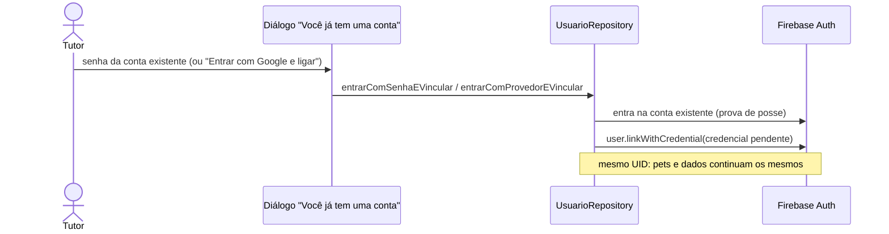

# Login com Google e Facebook (RF04-A, RF04-B)

> Branch: `feat/login-social-google-facebook` (2026-10-27). Fase 3 de
> `prompt_opus_memorial_apk_login_social_petconnect.md`. Decisões de
> identidade em `docs/decisions/0006-login-social-identidade-e-vinculacao.md`.

## Estado

| Parte | Situação |
|---|---|
| Código (app) | Pronto. Testado com fakes: 42 testes novos |
| Configuração do Google (Firebase e Google Cloud) | **Pendente do proprietário.** O `google-services.json` atual não tem cliente OAuth |
| Configuração do Facebook (Meta e Firebase) | **Pendente do proprietário.** Ainda não existe app na Meta |
| Teste real no aparelho | **Bloqueado** até as duas configurações acima |

Sem a configuração, os botões não quebram. Mostram "Entrar com o Google
(ou Facebook) ainda não está disponível nesta versão."

## Fluxo

```mermaid
sequenceDiagram
    actor Tutor
    participant UI as LoginScreen
    participant Repo as UsuarioRepository
    participant SDK as Google Sign-In / Facebook SDK
    participant FA as Firebase Auth
    participant FS as Firestore (Usuarios)
    Tutor->>UI: toca em Google (ou Facebook)
    UI->>UI: carregamento só no botão tocado; os outros logins ficam bloqueados
    UI->>Repo: entrarComProvedor(provedor)
    Repo->>SDK: escolher conta / autorizar (email, public_profile)
    alt cancelou
        SDK-->>UI: LoginSocialCancelado (sem mensagem)
    else autorizou
        SDK-->>Repo: idToken (Google) ou access token (Facebook)
        Repo->>FA: signInWithCredential
        alt conta com o mesmo e-mail por outro método
            FA-->>UI: ContaExisteComOutroMetodo → diálogo de vinculação
        else ok
            FA-->>Repo: User (UID canônico)
            Repo->>FS: cria Usuarios/{uid} só se não existir
            Note over UI,FA: redirect do go_router leva à Home
        end
    end
```



**Modo API** (`USE_API_USUARIO`): o mesmo fluxo. Depois de entrar, o
`GET /me` provisiona o tutor no MongoDB com o nome e o e-mail do token.

## Arquivos

| Arquivo | Papel |
|---|---|
| `lib/features/usuario/domain/login_social.dart` | `ProvedorSocial` e os erros do domínio |
| `lib/features/usuario/domain/usuario_repository.dart` | `entrarComProvedor`, `entrarComSenhaEVincular`, `entrarComProvedorEVincular` |
| `lib/features/usuario/data/provedores_sociais.dart` | Adaptadores dos SDKs: `GoogleProvedorDeCredencial` e `FacebookProvedorDeCredencial` |
| `lib/features/usuario/data/entrada_social.dart` | Fluxo sobre o Firebase Auth, comum ao modo Firestore e ao modo API |
| `lib/features/usuario/data/firebase_usuario_repository.dart` | Cria `Usuarios/{uid}` no primeiro login social; `signOut` sai também dos SDKs |
| `lib/features/usuario/data/api_usuario_repository.dart` | Mesmo fluxo, provisionando por `GET /me` |
| `lib/features/usuario/presentation/providers/auth_providers.dart` | `provedoresSociaisProvider` |
| `lib/features/auth/presentation/screens/login_screen.dart` | Botões, carregamento, mensagens e diálogo de vinculação |
| `lib/core/config/app_config.dart` | `GOOGLE_SERVER_CLIENT_ID` (opcional) |
| `android/app/build.gradle.kts`, `AndroidManifest.xml` | App ID e Client Token do Facebook vindos de `android/facebook.properties` (fora do Git); `<queries>` do app do Facebook |

## Erros e mensagens

| Situação | Origem | Mensagem no card |
|---|---|---|
| Cancelou no seletor ou na tela do provedor | `LoginSocialCancelado` | nenhuma |
| Provedor sem configuração no build ou no Console; provedor desligado no Firebase (`operation-not-allowed`) | `LoginSocialIndisponivel` | "Entrar com o X ainda não está disponível nesta versão." |
| Falha do SDK (interrompido, login já em andamento, sem token) | `LoginSocialFalhou` | "Não foi possível entrar com o X. Tente novamente." |
| Token expirado ou acesso revogado (`invalid-credential`) | Firebase | "O X não confirmou o login. Tente novamente." |
| Sem internet | Firebase | "Falha de conexão. Verifique sua internet." |
| Conta desativada | Firebase | "Esta conta está desativada." |
| Conta X já ligada a outro cadastro (`credential-already-in-use`) | Firebase | "Esta conta X já está ligada a outro cadastro." |
| Mesmo e-mail por outro método | `ContaExisteComOutroMetodo` | diálogo "Você já tem uma conta" |
| Senha errada no diálogo | Firebase | "E-mail ou senha inválidos." |
| Falha ao criar o perfil depois de entrar | Firestore ou API | sai da conta e mostra a mensagem genérica |

Nunca aparecem tokens, stack traces ou códigos internos.

## Identidade, dados e segurança

- **UID do Firebase Auth é a identidade.** Entrar com Google numa conta que
  já tem Google devolve o mesmo UID, e o perfil existente não é alterado.
- **Sem união automática pelo e-mail** (ADR 0006).
  - No conflito, o tutor prova a posse da conta existente (senha ou outro
    provedor) e só então o provedor novo é vinculado.
  - A credencial pendente fica só em memória.
- **Nenhuma transferência de pets entre UIDs.**
- **Esquema:** sem mudança. O perfil social usa os mesmos campos de
  `Usuarios`:
  - nome e sobrenome vêm do nome no provedor;
  - e-mail vem do provedor, ou fica vazio se o Facebook não informar;
  - telefone, nascimento e gênero ficam vazios, como nas contas antigas.
    O tutor completa em Editar perfil, sem uma tela nova de cadastro.
  - A **foto do provedor não é copiada.**
- **Regras do Firestore:** sem mudança. `Usuarios/{uid}` já só aceita o
  próprio UID, então nenhuma regra foi relaxada.
- **Permissões pedidas:**
  - Facebook: `email` e `public_profile`;
  - Google: autenticação básica (ID token), sem escopos extras.
- **Sair:** encerra o Firebase e os SDKs do Google e do Facebook. Assim o
  próximo login pergunta a conta de novo, e o tema da autenticação não muda.
- **Comportamento do Firebase com o Google:** com a opção padrão "uma conta
  por e-mail", entrar com Google num e-mail que tem conta por senha e
  **não verificada** faz o Firebase manter o UID e trocar o método pelo
  Google. Os pets continuam na mesma conta. É comportamento do Firebase,
  documentado aqui para não surpreender.

## Configuração por ambiente

| Item | Onde | Versionado? |
|---|---|---|
| Provedores Google e Facebook ligados | Firebase Console → Authentication | — |
| SHA-1 e SHA-256 das chaves (debug e upload) | Firebase → Configurações do projeto → app Android | — |
| `google-services.json` com o cliente OAuth web | `android/app/` | sim (não é segredo) |
| `GOOGLE_SERVER_CLIENT_ID` (opcional, alternativa ao json) | `--dart-define` | não |
| App ID e Client Token do Facebook | `android/facebook.properties` | **não** (`.gitignore`) |
| App Secret do Facebook | **só** no Firebase Console | **nunca** no app ou no repo |

Impressões das chaves de assinatura (públicas; tiradas dos APKs com
`apksigner`):

| Chave | SHA-1 | SHA-256 | Key hash (Facebook) |
|---|---|---|---|
| Debug (`~/.android/debug.keystore` deste computador) | `F4:CC:D3:4A:0E:0A:5E:DE:11:3D:FC:15:CA:49:4B:9F:C4:EF:EE:3B` | `6A:38:5F:C8:F3:49:84:4F:CA:AF:21:3D:B0:4F:FA:6E:92:10:62:66:EA:39:C9:34:86:18:A9:92:3C:8B:49:BF` | `9MzTSg4KXt4RPfwVyklLn8Tv7js=` |
| Upload (APK dos testadores) | `71:7E:20:45:B7:9E:33:90:9F:E2:C6:70:42:20:B4:AB:A4:7E:97:1F` | `81:23:E0:F9:B1:C1:01:5C:1D:C4:98:8F:53:B6:F6:D1:0A:AF:D8:C3:ED:12:A4:3D:6E:98:94:00:3B:F9:DB:EF` | `cX4gRbeeM5Cf4sZwQiC0q6R+lx8=` |

Na Play Store, a chave do Play App Signing tem impressões próprias, que
também precisam ser cadastradas.

## Checklist do proprietário (Console)

### Google

1. No [Firebase Console](https://console.firebase.google.com/project/pet-connect-c53f1/authentication/providers):
   - Authentication → Método de login → **Google** → Ativar;
   - escolher o e-mail de suporte → Salvar.
2. Em Configurações do projeto → Seus apps → app Android
   `com.petconnect.pet_connect` → **Adicionar impressão digital**:
   - as duas SHA-1 da tabela acima;
   - as duas SHA-256.
3. Na mesma tela, **baixar o `google-services.json`** novo e substituir
   `android/app/google-services.json`.
   - O novo arquivo passa a ter `oauth_client`. Avisar o Claude, que
     confere e faz o commit.

### Facebook

1. Em [developers.facebook.com](https://developers.facebook.com/apps):
   - **Criar app** → caso de uso "Autenticar e solicitar dados de usuários
     com o Login do Facebook";
   - nome PetConnect.
2. Configurações → Básico:
   - anotar o **ID do app** e a **Chave secreta do app**;
   - a chave secreta só vai para o Firebase.
3. Configurações → Avançado → Segurança: anotar o **Token do cliente**.
4. Adicionar plataforma **Android**:
   - pacote `com.petconnect.pet_connect`;
   - classe `com.petconnect.pet_connect.MainActivity`;
   - os dois **key hashes** da tabela acima.
5. No Firebase Console → Authentication → Método de login → **Facebook**:
   - Ativar e colar o ID do app e a chave secreta;
   - copiar o **URI de redirecionamento OAuth** mostrado ali.
6. Na Meta → Login do Facebook → Configurações: colar esse URI em **URIs de
   redirecionamento do OAuth válidos**.
7. Criar `android/facebook.properties`, que fica fora do Git:
   ```properties
   facebookAppId=<ID do app>
   facebookClientToken=<Token do cliente>
   ```
8. **Quem pode entrar:** com o app em modo de desenvolvimento, só quem
   tem papel no app (Funções do app → Testadores) consegue entrar com o
   Facebook.
   - Para os amigos testadores, adicione-os como testadores.
   - Outra opção é publicar o app na Meta, o que exige URL de política de
     privacidade e de instruções de exclusão de dados.

## Testes

| Arquivo | Casos |
|---|---|
| `test/features/usuario/login_social_repository_test.dart` (15) | Primeiro login cria o perfil (nome, sobrenome, e-mail; foto não copiada); Facebook sem e-mail ou nome; login repetido não altera nem duplica o perfil; cancelado não chega ao Firebase; provedor ausente ou desligado = indisponível; token inválido sobe; conflito de conta sem união e sem perfil novo; vincular com senha certa (mesmo UID) e errada (nada vinculado); vincular entrando com Google; provedor já vinculado; sair encerra o Firebase e os SDKs; falha ao criar o perfil sai da conta; modo API provisiona com `GET /me` |
| `test/features/usuario/provedores_sociais_test.dart` (14) | Google: cancelado, 3 erros de configuração, interrompido, sem suporte, inicialização única com nova tentativa, sair. Facebook: sucesso com só `email` e `public_profile`, cancelado, falha ou em andamento, sucesso sem token, SDK sem App ID, sair |
| `test/features/auth/login_social_screen_test.dart` (13) | Carregamento só no botão tocado, com os outros bloqueados; toque duplo faz um login só; cancelado sem mensagem; 5 mensagens sem mover o card; diálogo de vinculação com senha, senha errada, entrar com Google e cancelar; login por e-mail inalterado |

**Não executado ou bloqueado:**
- Login real com Google e Facebook no aparelho: bloqueado pela
  configuração do Console.
- App do Facebook instalado ou não, retorno do navegador e segundo plano
  durante o login: dependem do teste real.
- Reinstalação e conta revogada no provedor: dependem do teste real.

Checklist em `docs/validation/login-social.md`.

## Riscos e pendências

- **Exclusão de conta de quem entrou com Google ou Facebook:** o Firebase
  pode pedir login recente (`requires-recent-login`). A reautenticação
  social na exclusão fica para a tarefa de exclusão de conta, que está em
  outra sessão e mexe no mesmo método.
- **ID de publicidade:** o SDK do Facebook adiciona as permissões `AD_ID` e
  `ACCESS_ADSERVICES_*`. O app não usa anúncios.
  - Avaliar a remoção no manifesto e declarar o uso na Play Store.
- **Modo de desenvolvimento na Meta:** limita quem pode entrar com o
  Facebook (veja o passo 8 do checklist).

## Rollback

Reverter o merge.
- Contas criadas por Google ou Facebook continuam no Firebase Auth e em
  `Usuarios`, mas sem os botões não conseguem entrar.
- Para devolver o acesso a elas, o proprietário pode mandar um link de
  redefinição de senha.
