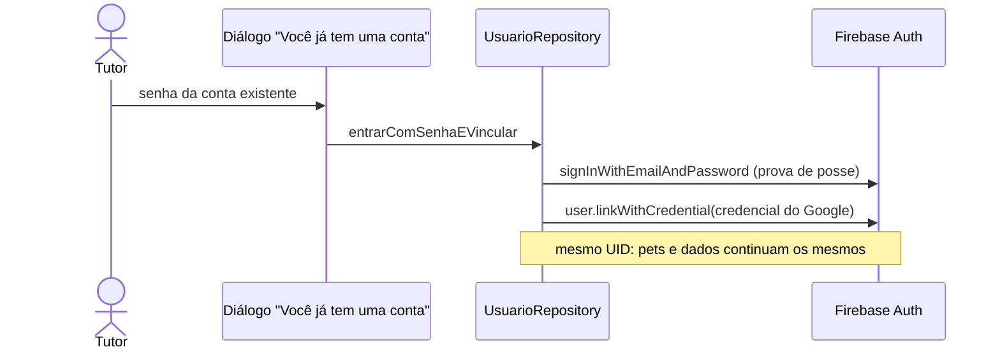

# Login com Google (RF04-A)

> Branch: `feat/login-social-google-facebook` (2026-10-27). Fase 3 de
> `prompt_opus_memorial_apk_login_social_petconnect.md`. Decisões de
> identidade em `docs/decisions/0006-login-social-identidade-e-vinculacao.md`.
>
> **Facebook (RF04-B) fora do escopo:** decisão do proprietário em
> 2026-10-27, porque ele não tem conta no Facebook.
> - O botão, o código, a dependência `flutter_facebook_auth` e a
>   configuração Android foram removidos.
> - Com isso saíram também as permissões de ID de publicidade que o SDK da
>   Meta trazia: `AD_ID` e `ACCESS_ADSERVICES_*`. Conferido com
>   `aapt2 dump badging` no APK de release do commit `e8b292d`.
> - Se voltar, a estrutura (`ProvedorSocial`, `ProvedorDeCredencial`,
>   `EntradaSocial`) aceita um novo provedor sem mudar o fluxo.

## Estado

| Parte | Situação |
|---|---|
| Código (app) | Pronto. Testado com fakes |
| Firebase | **Feito pelo proprietário (2026-10-27):** provedor Google ativado, SHA-1 e SHA-256 das chaves de debug e upload cadastradas, `google-services.json` novo baixado |
| `google-services.json` | Conferido: mesmo projeto e mesmos apps, cliente OAuth web (tipo 3) e clientes Android (tipo 1) para as duas chaves. O arquivo é ignorado pelo Git (`.gitignore`), então fica só no computador que gera o build |
| Teste real no aparelho | Pendente com o proprietário: roteiro em `docs/validation/login-social.md` |

Num build sem o cliente OAuth no `google-services.json`, o botão não
quebra: mostra "Entrar com o Google ainda não está disponível nesta
versão."

## Fluxo

```mermaid
sequenceDiagram
    actor Tutor
    participant UI as LoginScreen
    participant Repo as UsuarioRepository
    participant SDK as Google Sign-In (Credential Manager)
    participant FA as Firebase Auth
    participant FS as Firestore (Usuarios)
    Tutor->>UI: toca em "Entrar com Google"
    UI->>UI: carregamento no botão; ENTRAR bloqueado
    UI->>Repo: entrarComProvedor(google)
    Repo->>SDK: escolher a conta
    alt fechou o seletor
        SDK-->>UI: LoginSocialCancelado (sem mensagem)
    else escolheu
        SDK-->>Repo: idToken
        Repo->>FA: signInWithCredential(GoogleAuthProvider)
        alt e-mail com conta por senha (conflito)
            FA-->>UI: ContaExisteComOutroMetodo → diálogo pede a senha
        else ok
            FA-->>Repo: User (UID canônico)
            Repo->>FS: cria Usuarios/{uid} só se não existir
            Note over UI,FA: redirect do go_router leva à Home
        end
    end
```



**Modo API** (`USE_API_USUARIO`): o mesmo fluxo. Depois de entrar, o
`GET /me` provisiona o tutor no MongoDB com o nome e o e-mail do token.

## Arquivos

| Arquivo | Papel |
|---|---|
| `lib/features/usuario/domain/login_social.dart` | `ProvedorSocial` (só `google`) e os erros do domínio |
| `lib/features/usuario/domain/usuario_repository.dart` | `entrarComProvedor` e `entrarComSenhaEVincular` |
| `lib/features/usuario/data/provedores_sociais.dart` | `GoogleProvedorDeCredencial` (google_sign_in 7) |
| `lib/features/usuario/data/entrada_social.dart` | Fluxo sobre o Firebase Auth, comum ao modo Firestore e ao modo API |
| `lib/features/usuario/data/firebase_usuario_repository.dart` | Cria `Usuarios/{uid}` no primeiro login; `signOut` sai também do Google |
| `lib/features/usuario/data/api_usuario_repository.dart` | Mesmo fluxo, provisionando por `GET /me` |
| `lib/features/usuario/presentation/providers/auth_providers.dart` | `provedoresSociaisProvider` |
| `lib/features/auth/presentation/screens/login_screen.dart` | Botão "Entrar com Google" na largura do card, carregamento, mensagens e diálogo de vinculação |
| `lib/core/config/app_config.dart` | `GOOGLE_SERVER_CLIENT_ID` (opcional; o padrão é o `google-services.json`) |

A configuração Android não muda: o Google Sign-In lê o cliente do
`google-services.json`.

## Erros e mensagens

| Situação | Origem | Mensagem no card |
|---|---|---|
| Fechou o seletor de conta | `LoginSocialCancelado` | nenhuma |
| Sem cliente OAuth no build, erro de configuração ou provedor desligado no Firebase (`operation-not-allowed`) | `LoginSocialIndisponivel` | "Entrar com o Google ainda não está disponível nesta versão." |
| Falha do SDK (interrompido, sem token) | `LoginSocialFalhou` | "Não foi possível entrar com o Google. Tente novamente." |
| Token expirado ou acesso revogado (`invalid-credential`) | Firebase | "O Google não confirmou o login. Tente novamente." |
| Sem internet | Firebase | "Falha de conexão. Verifique sua internet." |
| Conta desativada | Firebase | "Esta conta está desativada." |
| Conta Google já ligada a outro cadastro (`credential-already-in-use`) | Firebase | "Esta conta Google já está ligada a outro cadastro." |
| E-mail com conta por senha (conflito) | `ContaExisteComOutroMetodo` | diálogo "Você já tem uma conta" |
| Senha errada no diálogo | Firebase | "E-mail ou senha inválidos." |
| Falha ao criar o perfil depois de entrar | Firestore ou API | sai da conta e mostra a mensagem genérica |

Nunca aparecem tokens, stack traces ou códigos internos.

## Identidade, dados e segurança

- **UID do Firebase Auth é a identidade.** Entrar de novo com a mesma
  conta Google devolve o mesmo UID, e o perfil existente não é alterado.
- **Sem união automática pelo e-mail** (ADR 0006).
  - No conflito, o tutor prova a posse da conta existente pela senha, e só
    então o Google é vinculado.
  - A credencial pendente fica só em memória.
- **Comportamento do Firebase com o Google:** o Google é um provedor
  confiável. Com "uma conta por e-mail", entrar com Google num e-mail que
  tem conta por senha **não verificada** faz o Firebase manter o UID e
  trocar o método pelo Google, sem erro de conflito.
  - Os pets continuam na mesma conta.
  - O diálogo de vinculação aparece quando o Firebase devolve o conflito.
- **Nenhuma transferência de pets entre UIDs.**
- **Esquema:** sem mudança. O perfil usa os mesmos campos de `Usuarios`:
  - nome e sobrenome vêm do nome no Google;
  - e-mail vem do Google;
  - telefone, nascimento e gênero ficam vazios, como nas contas antigas.
    O tutor completa em Editar perfil.
  - A **foto do Google não é copiada.**
- **Regras do Firestore:** sem mudança. Nenhuma regra foi relaxada.
- **Escopos:** só a autenticação básica (ID token), sem escopos extras.
- **Sair:** encerra o Firebase e o Google Sign-In, para o próximo login
  perguntar a conta. O tema da autenticação não muda.

## Configuração por ambiente

| Item | Onde | Versionado? |
|---|---|---|
| Provedor Google ligado | Firebase Console → Authentication | — |
| SHA-1 e SHA-256 das chaves (debug e upload) | Firebase → Configurações do projeto → app Android | — |
| `google-services.json` com o cliente OAuth web | `android/app/` | **não** (`.gitignore`); baixar do Firebase em cada computador que gera build |
| `GOOGLE_SERVER_CLIENT_ID` (opcional) | `--dart-define` | não |
| Chave secreta do cliente web | não é usada pelo app | nunca |

Impressões cadastradas (públicas; tiradas dos APKs com `apksigner`):

| Chave | SHA-1 | SHA-256 |
|---|---|---|
| Debug (`~/.android/debug.keystore` deste computador) | `F4:CC:D3:4A:0E:0A:5E:DE:11:3D:FC:15:CA:49:4B:9F:C4:EF:EE:3B` | `6A:38:5F:C8:F3:49:84:4F:CA:AF:21:3D:B0:4F:FA:6E:92:10:62:66:EA:39:C9:34:86:18:A9:92:3C:8B:49:BF` |
| Upload (APK dos testadores) | `71:7E:20:45:B7:9E:33:90:9F:E2:C6:70:42:20:B4:AB:A4:7E:97:1F` | `81:23:E0:F9:B1:C1:01:5C:1D:C4:98:8F:53:B6:F6:D1:0A:AF:D8:C3:ED:12:A4:3D:6E:98:94:00:3B:F9:DB:EF` |

**Play Store:** a chave do Play App Signing tem impressões próprias, que
precisam ser cadastradas antes do lançamento. Depois, baixe o
`google-services.json` de novo.

## Testes

| Arquivo | Casos |
|---|---|
| `test/features/usuario/login_social_repository_test.dart` (14) | Primeiro login cria o perfil (nome, sobrenome, e-mail; foto não copiada); sem nome nem e-mail; login repetido não altera nem duplica; cancelado não chega ao Firebase; provedor ausente ou desligado = indisponível; token inválido sobe; conflito de conta sem união e sem perfil novo; vincular com senha certa (mesmo UID), senha errada (nada vinculado) e já vinculado; sair encerra o Firebase e o Google; falha ao criar o perfil sai da conta; modo API provisiona com `GET /me` |
| `test/features/usuario/provedores_sociais_test.dart` (8) | Cancelado, 3 erros de configuração = indisponível, interrompido = falhou, sem suporte, inicialização única com nova tentativa, sair |
| `test/features/auth/login_social_screen_test.dart` (13) | Sem botão do Facebook; carregamento e ENTRAR bloqueado; toque duplo faz um login só; cancelado sem mensagem; 5 mensagens sem mover o card; diálogo com senha certa, senha errada e cancelar; login por e-mail inalterado |
| `test/features/auth/login_screen_test.dart` | Botão do Google 24–32 px abaixo do card, na largura dele, e "Cadastre-se" 16–24 px abaixo, em 320, 360, 390 e 412 de largura |

**Pendente no aparelho:** login real, cancelamento, segundo plano, modo
avião, conta revogada e conflito com conta por senha (LS01–LS12).

## Riscos e pendências

- **Exclusão de conta de quem entrou com Google:** o Firebase pode pedir
  login recente (`requires-recent-login`). A reautenticação fica para a
  tarefa de exclusão de conta, que mexe no mesmo método.
- **Novo computador de build:** é preciso baixar o `google-services.json`
  do Firebase, porque ele não está no Git.
- **APK dos testadores:** a versão 0.1.0 já distribuída ainda não tem o
  login com Google. Ele entra no próximo APK.

## Rollback

Reverter o merge.
- Contas criadas pelo Google continuam no Firebase Auth e em `Usuarios`,
  mas sem o botão não conseguem entrar.
- Para devolver o acesso a elas, o proprietário pode mandar um link de
  redefinição de senha.
