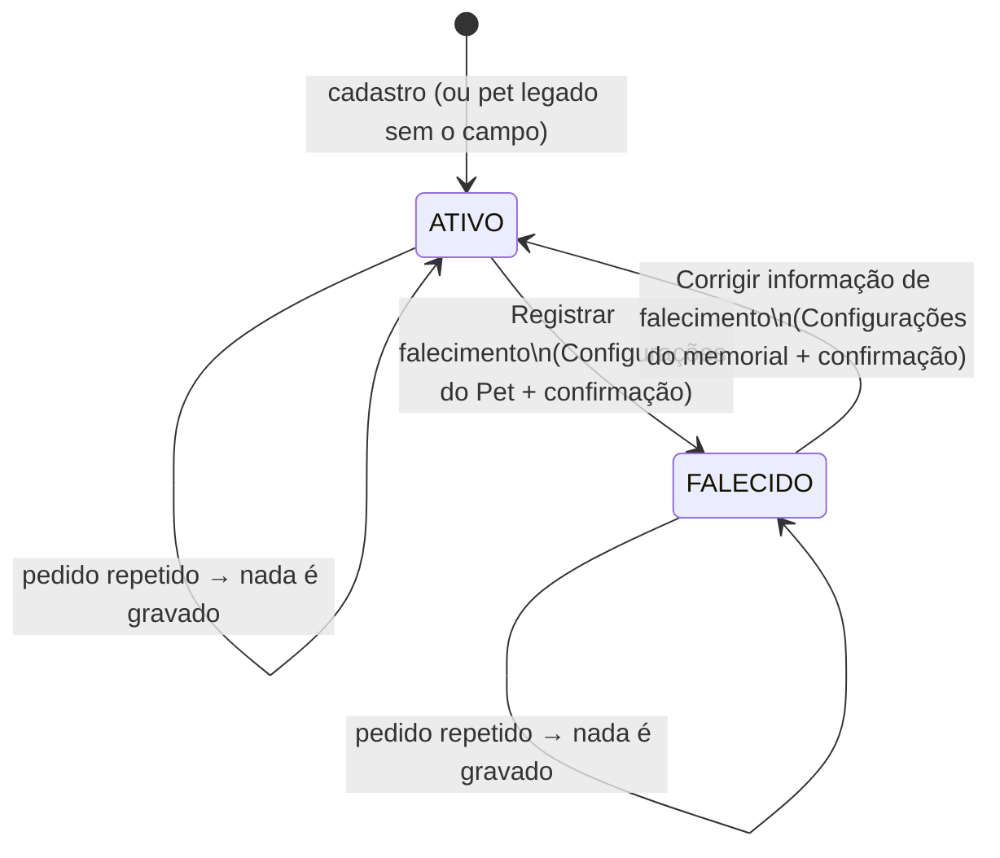
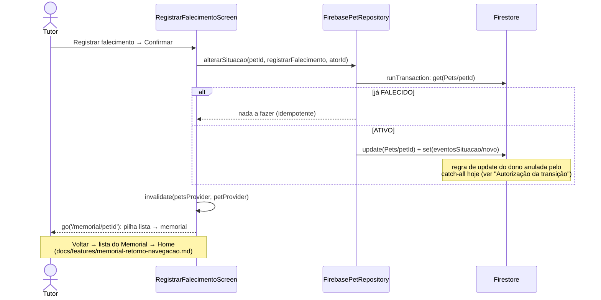

# Memorial do Pet

> Branch: `feat/memorial-pet`. Fonte:
> `prompt_claude_opus_tema_auth_memorial_pet.md` (Entrega B, 2026-10-24).
> Decisão: `docs/decisions/0002-arquivamento-logico-pets-falecidos.md`.
> Segurança e retenção: `docs/security/memorial-pet.md` e
> `docs/privacy/retencao-pets-falecidos.md`.

## Objetivo

O tutor pode registrar o falecimento de um pet. O perfil vira um
**memorial privado**, visível só para ele, com foto, capa, nome,
informações básicas, homenagem e lembranças. As funcionalidades
operacionais (vacinas, consultas, histórico, localização, edição, QR)
deixam de aparecer. **Nenhum dado é apagado**, e uma marcação feita por
engano pode ser corrigida.

## Fonte de dados (estado real do código)

| Modo | Pets vêm de | Memorial |
|---|---|---|
| Padrão (sem `--dart-define`) | **Firestore** (`FirebasePetRepository`) | ✅ Implementado |
| `USE_API_PETS=true` | API Spring/MongoDB (`ApiPetRepository`) | ⛔ Desligado de propósito (ver abaixo) |

**Por que o modo API fica desligado.** A API já tem `status: DECEASED` e
só deixa o dono alterar (`PetService.ownedOr404`). Porém, a página pública
do QR (`public/index.html`, via `GET /api/v1/public/pets/{publicId}`)
mostra esse status como **"Falecido"**. Registrar o falecimento pela API
exporia o fato publicamente, o que viola a regra do produto de não expor o
falecimento por padrão. Nesse modo:

- `suportaMemorial` é `false` e a opção "Registrar falecimento" não
  aparece;
- `alterarSituacao` falha sem chamar a API;
- pets que já estejam `DECEASED` na API aparecem no Memorial (só leitura).
  Os outros status da API (`LOST`, `FOUND`, `ARCHIVED`) não têm
  equivalente no app e continuam como ativos.

Liberar o modo API depende de uma mudança aprovada no backend (ver
"Pendências").

## Modelo (Firestore, mudança aditiva)

Novos campos no documento `Pets/{petId}`, todos opcionais:

| Campo | Tipo | Regra |
|---|---|---|
| `situacao` | `"ATIVO"` \| `"FALECIDO"` | **Ausente = ATIVO.** É seguro porque, até esta versão, não havia como registrar falecimento, então nenhum pet legado pode estar falecido. |
| `dataFalecimento` | string `dd/MM/yyyy` | Opcional e nunca inventada; removida na correção. |
| `homenagem` | string (até 280) | Opcional; removida na correção. |
| `situacaoAtualizadaEm` | timestamp do servidor | Data/hora técnica da última transição. |

Nova subcoleção de auditoria, `Pets/{petId}/eventosSituacao/{auto}`:
`atorId`, `situacaoAnterior`, `situacaoNova`, `motivo`
(`registro_falecimento` / `correcao_marcacao`), `resultado: "aplicado"`,
`origem: "app"` e `em` (timestamp do servidor). Não guarda data de
falecimento nem homenagem.

**Sem migração de dados.** Não é preciso escrever nada nos pets
existentes. `Pet.toMap()` não inclui os campos de situação, então editar o
perfil (`updatePet`) nunca altera a situação: ela só muda por
`PetRepository.alterarSituacao`.

## Estados e transições

A transação lê a situação e só grava se ela mudar. Por isso, um toque
duplo, uma repetição após falha de rede ou dois aparelhos ao mesmo tempo
nunca geram dois eventos nem deixam o estado pela metade (pet atualizado
sem evento, ou o contrário).

## Fluxos e telas

| Fluxo | Caminho |
|---|---|
| Registrar | Perfil do pet → Configurações do Pet → seção **Memorial** → "Registrar falecimento" (`/pet/:id/falecimento`) → explicação + data e homenagem opcionais → **diálogo de confirmação** → Memorial do pet |
| Visitar | Home → entrada **Memorial** (só aparece se houver pet falecido) → lista (`/memorial`) → memorial (`/memorial/:id`) |
| Corrigir | Memorial → ⚙ Configurações do memorial (`/memorial/:id/configuracoes`) → "Corrigir informação de falecimento" → confirmação → perfil ativo (`/pet/:id`) |
| Voltar | Depois do registro: memorial → lista do Memorial → Home. Lista ou perfil sozinhos na pilha (link direto, perfil restaurado): Voltar e seta da AppBar levam à Home, nunca fecham o app. Ver `docs/features/memorial-retorno-navegacao.md` |

- A ação **não** está na Home nem no menu do tutor. Fica numa seção
  própria das Configurações do Pet, longe de toques acidentais.
- **Memorial** (`MemorialScreen`) mostra:
  - capa e foto (`PetCoverImage`/`PetAvatar`, reaproveitados);
  - "Em memória de" e o nome;
  - nascimento – falecimento, quando existirem;
  - espécie, raça, sexo e cor, só os preenchidos;
  - homenagem;
  - **Lembranças**: foto de perfil e capa do próprio pet, ampliáveis em
    tela cheia, com aviso quando não há fotos.

  Não mostra idade (ela continuaria contando), "Vacinado", peso nem
  nenhum card clínico.
- **Galeria:** o app não tem galeria por pet. As únicas imagens não
  clínicas vinculadas ao pet são `foto` e `capa`, que formam as
  Lembranças. As fotos anexadas ao histórico médico são registros
  clínicos e ficam de fora. Uma galeria de verdade (upload de várias
  fotos) está fora do escopo deste MVP.
- Linguagem sem alarme, sem animações, sem símbolos obrigatórios de luto
  (o ícone usado é uma flor discreta). Todas as telas usam `context.colors`
  e respondem aos temas Padrão, Claro e Escuro.

## Proteções

- **Rotas** (`lib/routing/pet_routes.dart`): as rotas de pet são
  protegidas por `PetSituacaoGuard`:
  - as operacionais (`/pet/:id`, `/editar`, `/configuracoes`,
    `/vacinas(/nova|/:id/editar)`, `/historico(...)`,
    `/consultas(...)`, `/localizacao(...)` e `/falecimento`) só abrem para
    pet **ativo**;
  - as do memorial só abrem para pet **falecido**.

  Isso vale para links diretos e antigos, não só para os botões. Um pet
  bloqueado mostra uma mensagem e o caminho certo ("Abrir memorial" ou
  "Abrir perfil"). Pet de outra conta mostra "Pet não encontrado."
- **Mutações clínicas:** as telas de cadastro/edição de vacina, consulta,
  histórico e localização não abrem para pet falecido, então nenhum fluxo
  do tutor grava registros novos. Bloquear também nas regras do Firestore
  depende de aprovação (ver "Pendências").
- **Autorização da transição:** hoje só o app impede (o
  `PetSituacaoGuard` e a consulta por `userId`). A regra deployada
  `match /Pets/{petId} { allow update: if request.auth.uid ==
  resource.data.userId }` não basta: o catch-all `/{document=**}` com
  `allow write` para qualquer usuário logado também casa `Pets/{id}`, e
  blocos `match` somam por OR. Correção de 2026-10-26 — a versão anterior
  deste texto dizia que a regra fazia a transação falhar para outra conta,
  o que está errado. O isolamento no servidor é a Fase 1 (#31).
- **Isolamento:** a lista do Memorial e a lista de ativos vêm da mesma
  consulta já filtrada por `userId` (`petsProvider`), sem consulta extra
  nem N+1.
- **Desempenho:** o memorial usa só o documento do pet. Os testes
  confirmam que nenhuma vacina, consulta, histórico ou localização é
  buscada ao abri-lo.

## Agendamentos pendentes e QR code

- **Consultas agendadas** de um pet falecido **não são apagadas nem
  canceladas** automaticamente. Elas ficam guardadas e ocultas, e voltam se
  a marcação for corrigida. A Home só calcula alertas de vacina para pets
  ativos, porque a lista de ativos é a única que ela renderiza. Não há
  notificações agendadas no app hoje (sem `flutter_local_notifications`),
  então não há lembrete a cancelar.
- **QR code:** nada mudou. No modo Firestore, a situação não chega à API
  que alimenta a página pública, então o falecimento não é exposto. No
  modo API o Memorial fica desligado, justamente para não expor. A política
  de QR para pets falecidos (desativar, mostrar como ativo ou
  personalizar) é uma decisão de produto pendente.

## Testes

| Arquivo | Cobertura |
|---|---|
| `test/features/pet/memorial_repository_test.dart` (11) | Domínio: legado é ativo, valor desconhecido é ativo, `toMap` sem situação, campos vazios. `FirebasePetRepository` com `fake_cloud_firestore`: registro com data, homenagem e auditoria; sem data não inventa; repetição e concorrência sem evento duplicado; correção restaura sem tocar em vacinas, consultas e histórico; editar perfil mantém a situação; pet inexistente. |
| `test/features/pet/memorial_flow_test.dart` (28) | Rotas reais (`buildPetRoutes`): Home só com ativos e entrada do Memorial; lista sem duplicação; fluxo de registro com cancelamento e confirmação; falha de gravação; modo sem suporte; memorial com dados, campos ausentes e galeria só do pet; nada clínico exibido ou buscado; 12 deep links bloqueados; memorial de pet ativo bloqueado; pet de outra conta; correção restaura e volta para a Home; 320×568 com fonte 1.3 nos três temas. |
| `test/features/pet/memorial_navegacao_test.dart` (14) | Pilha de navegação: registrar → Voltar → lista → Voltar → Home nos três temas, com seta da AppBar e botão do sistema; último pet vivo; vários no Memorial; link direto; falha ao gravar; toque duplo; Memorial aberto sem histórico; pet já falecido; app reaberto; perfil restaurado volta à Home. Nenhum caso fecha o app. |
| `test/features/pet/api_pet_repository_memorial_test.dart` (2) | Modo API: `DECEASED` é lido como falecido; registrar não chama a API. |

Verificação de mutação: sem o `PetSituacaoGuard`, os 12 testes de deep
link falham.

**Não automatizado (limitação real):** teste negativo das regras do
Firestore com outra conta. O `fake_cloud_firestore` não avalia
`resource.data` nas regras, e o Firestore Emulator (Java) não roda nesta
máquina (bug de loopback, `docs/migration/handoff.md`). A regra usada é a
mesma, já em produção, que protege a edição de pets (RF12), e a validação
manual está no checklist.

## Limites do MVP

- Sem galeria com upload de várias fotos (Lembranças = foto + capa).
- Sem memorial no modo API.
- Sem compartilhamento público do memorial.

## Pendências (dependem de aprovação)

1. **Regras do Firestore** (deploy em produção): bloquear criação e edição
   em `vacinas`, `consultas`, `historicoMedico` e `localizacoes` quando o
   pet pai estiver `FALECIDO`, e restringir `eventosSituacao` ao dono e só
   a `create`. Hoje o catch-all permite escrita em subcoleções a qualquer
   usuário logado (situação anterior a esta entrega). Proposta em
   `docs/security/memorial-pet.md`.
2. **Backend (PetConnect-API):** omitir `status` (ou mapear `DECEASED`
   para um valor neutro) em `PublicPetSummaryResponse`; aceitar
   `deceasedAt` e `tribute`; auditar a transição; recusar
   vacinas e consultas novas para pet `DECEASED`. Depois disso,
   `ApiPetRepository.suportaMemorial` pode ser ligado.
3. **Política de QR** para pets falecidos (decisão de produto).
4. **Retenção e exclusão futura:** planejamento em
   `docs/privacy/retencao-pets-falecidos.md`, sem exclusão automática.

## Rollback

Reverter o merge. Pets marcados continuam com `situacao: "FALECIDO"` no
documento, campo que a versão anterior ignora: eles voltam a aparecer
como ativos e nada se perde. Para limpar, basta remover os campos
`situacao`, `dataFalecimento`, `homenagem` e `situacaoAtualizadaEm`, e a
subcoleção `eventosSituacao` pode ficar como histórico.

## Validação manual

`docs/validation/memorial-pet.md`.
