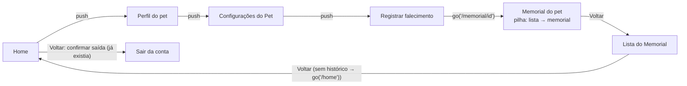
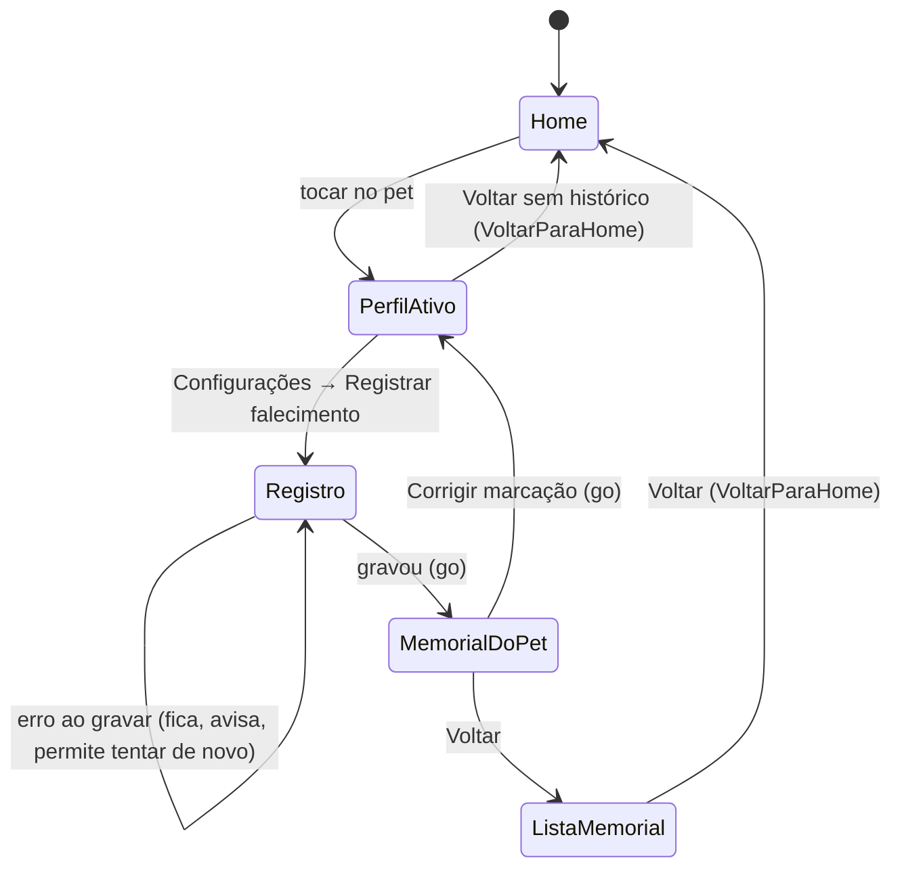

# Memorial: Voltar depois de registrar o falecimento

> Branch: `fix/memorial-retorno-navegacao` (2026-10-27). Fase 1 de
> `prompt_opus_memorial_apk_login_social_petconnect.md`. Relato do
> proprietário: depois de registrar o falecimento, tocar em **Voltar**
> fechava o app.

## Causa raiz

- **Como terminava o registro:** `RegistrarFalecimentoScreen` chamava
  `router.go('/memorial/<id>')`.
- **Por que isso esvaziava a pilha:** as rotas do Memorial estavam todas no
  nível raiz de `lib/routing/pet_routes.dart`. No go_router, o `go` monta a
  pilha a partir da hierarquia das rotas, e uma rota sem pai vira uma pilha
  de **uma tela só**.
  - O perfil, as Configurações do Pet e o registro saíam da pilha, como
    devem: o pet não está mais ativo.
  - Mas a lista do Memorial e a Home também saíam.
- **O efeito:** no Voltar, o `Navigator` não tinha o que tirar da pilha, e
  o Android fechava a Activity (`SystemNavigator.pop`).
- **Evidência:** o teste `memorial_navegacao_test.dart`, rodado antes da
  correção.
  - A pilha depois do registro era `['/memorial/<id>']`, quando o esperado
    era `['/memorial', '/memorial/<id>']`.
  - 12 dos 14 casos novos falhavam.
  - Desfazendo só o aninhamento das rotas, 10 voltam a falhar.
- **O mesmo defeito em outros pontos:**
  - **Corrigir marcação:** `router.go('/pet/<id>')` deixava o perfil
    sozinho na pilha.
  - **Lista do Memorial aberta direto** (link ou app reaberto): também
    ficava sozinha e sem seta de voltar.

Não havia `pop` duplo, `BuildContext` obsoleto nem redirect em loop. A
navegação depois do `await` já usava o `GoRouter` capturado antes, que é o
cuidado certo, porque o guard troca a tela quando a situação muda.

## Correção

1. **Rotas do Memorial aninhadas, com os mesmos caminhos:**
   - `/memorial` → `:id` → `configuracoes`;
   - links antigos e `push` continuam iguais;
   - o mesmo `go('/memorial/<id>')` agora monta **lista → memorial**.
2. **`VoltarParaHome`** (`lib/core/widgets/voltar_para_home.dart`): para
   telas que podem ficar sozinhas na pilha, hoje a lista do Memorial e o
   perfil do pet. Sem tela anterior:
   - o Voltar do sistema (botão ou gesto) leva à Home;
   - a AppBar ganha a seta, com o mesmo destino;
   - com histórico, nada muda.
3. **Sem mudança:**
   - a gravação (`alterarSituacao`, transação e auditoria);
   - a invalidação dos providers;
   - o tratamento de erro e a proteção contra toque duplo;
   - o restaurar perfil.

## Banco de dados e segurança

**Sem alteração de esquema, de regras ou de dados.** A mudança é só de
navegação. Nada é apagado: vacinas, consultas, histórico e fotos ficam
como estavam.

## Testes (`test/features/pet/memorial_navegacao_test.dart`, 14)

- **Caminho completo:** Home → perfil → Configurações → registrar →
  memorial → Voltar → lista (com o pet) → Voltar → Home, sem o pet entre
  os vivos.
  - Roda nos temas Padrão, Claro e Escuro.
  - Sem fechar o app: o teste intercepta `SystemNavigator.pop`.
- **Seta da AppBar:** faz o mesmo caminho do botão do sistema.
- **Último pet vivo:** a Home volta vazia, com a entrada do Memorial.
- **Vários pets no Memorial:** a lista mostra todos, sem repetir.
- **Registro aberto por link direto:** o Voltar ainda passa pela lista e
  chega à Home.
- **Falha ao gravar:**
  - fica na tela, sem evento gravado;
  - o Voltar retorna às Configurações.
- **Toque duplo:** um só diálogo, um só registro e uma só tela.
- **Memorial sem histórico:**
  - lista aberta direto: seta e botão do sistema levam à Home;
  - memorial de um pet aberto direto: monta lista → memorial;
  - pet já falecido no perfil antigo: "Abrir memorial" e depois Voltar
    chegam à Home;
  - app reaberto: Home sem o pet, Memorial com.
- **Corrigir marcação:** o perfil restaurado, sozinho na pilha, volta para
  a Home.

**Não automatizado:**
- **Gesto de voltar preditivo do Android 14+:** o teste usa o mesmo
  caminho do botão (`handlePopRoute`). Validar no aparelho.
- **Restauração de estado pelo sistema** (processo morto em segundo plano):
  o app não usa `restorationScopeId`; ao reabrir, começa pela splash.

## Limites

- **Outras telas abertas direto por link** (por exemplo `/pet/<id>/vacinas`)
  continuam sem fallback para a Home. Elas não fazem parte deste fluxo, e o
  app não registra deep links no Android hoje.
- **Home:** o Voltar continua pedindo para sair da conta, como já fazia.

## Rollback

Reverter o merge. A mudança é só de rotas e telas.
